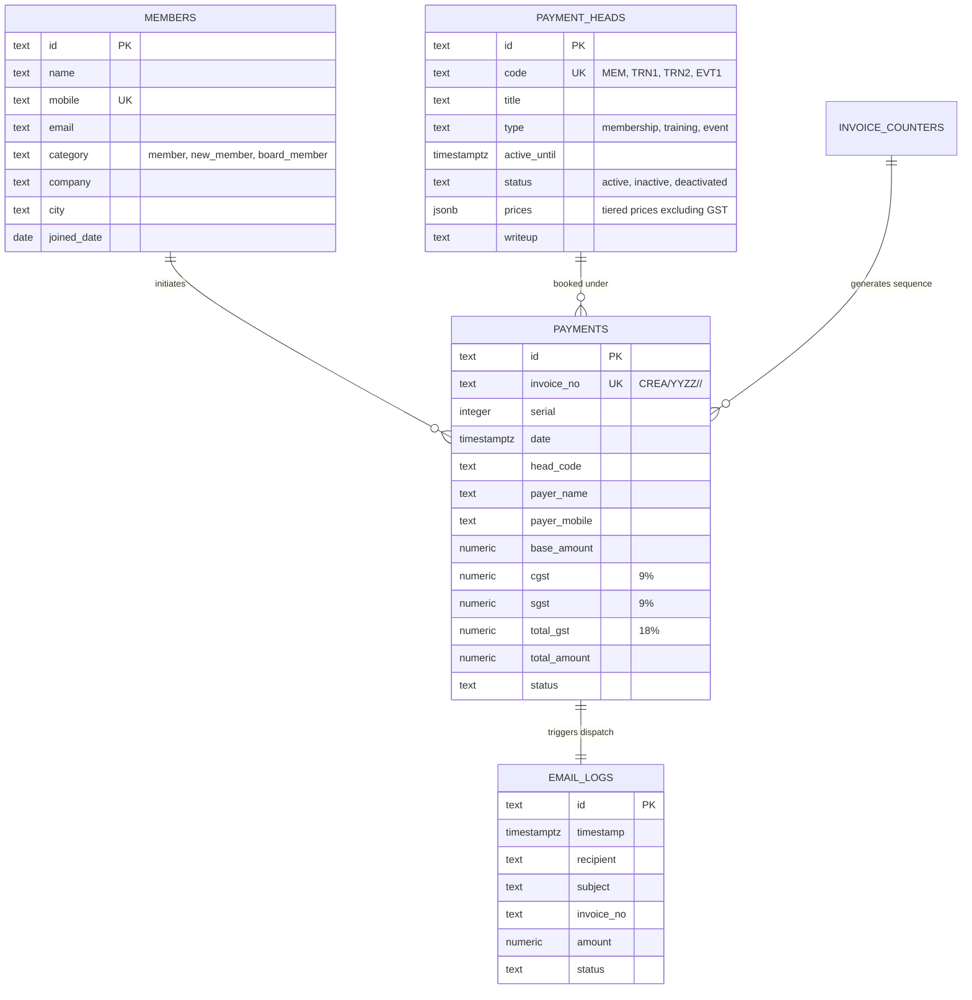

# CREA(I) System Architecture

## Overview
The **CREA(I) Payment & Membership Management Suite** (*Confederation of Real Estate Associates - India*) is architected as a modern, high-performance web application designed for seamless execution on **Vercel Serverless Infrastructure**, backed by **Supabase (PostgreSQL)** for transactional persistence, row-level security (RLS), and real-time updates.

```mermaid
graph TD
    Client["Client Web App (Mobile Responsive Single-Page Application)"]
    VercelEdge["Vercel Global Edge Network / CDN"]
    VercelFunctions["Vercel Serverless API Functions (Node.js 20.x+)"]
    SupabaseAuth["Supabase Auth (Admin & Member Sessions)"]
    SupabaseDB["Supabase PostgreSQL 15+ (RLS & Realtime)"]
    FallbackStore["Resilient Local / In-Memory JSON Store (Auto-Fallback)"]

    Client -->|HTTPS / WSS| VercelEdge
    VercelEdge -->|Static Assets| Client
    VercelEdge -->|API Calls (/api/*)| VercelFunctions
    VercelFunctions -->|Verify Session / Token| SupabaseAuth
    VercelFunctions -->|Direct Queries / Mutations via @supabase/supabase-js| SupabaseDB
    VercelFunctions -.->|Graceful Fallback if DB Unreachable| FallbackStore
    Client -.->|Real-time Subscriptions (Live Transactions)| SupabaseDB
```

---

## Core Components

### 1. Hosting & Compute (Vercel)
- **Edge Routing & Global CDN**: All static application assets (`index.html`, stylesheets, scripts) are globally cached across Vercel’s Anycast Edge Network with sub-50ms latency.
- **Serverless API Runtime**: Headless API routes located in `/api/*` run as Node.js serverless functions (ES Modules, Node.js 20.x/22.x).
- **Stateless Execution**: Every request (Payment processing, Head creation, Member lookup) executes statelessly within milliseconds.
- **Environment Management**: Environment configurations (`NEXT_PUBLIC_SUPABASE_URL`, `SUPABASE_SERVICE_ROLE_KEY`, `ADMIN_SECRET_KEY`) managed across Preview and Production environments via Vercel CLI and Dashboard.
- **CI/CD Integration**: Automatic build and zero-downtime deployments triggered on push to `main` and branch pull requests.

### 2. Backend & Data Layer (Supabase)
- **Database Engine**: PostgreSQL 15+ running on Supabase with native JSONB support for multi-tier pricing.
- **Sequential Invoicing Engine**: Stored procedure `fn_next_invoice_number` provides atomic, monotonic sequential invoice generation (`CREA/2627/<HEAD>/<0001>`) ensuring zero race conditions even under concurrent checkouts.
- **Row-Level Security (RLS)**: Enforces database-level isolation:
  - Public/Guests: Can read active payment heads and insert new checkout transactions.
  - Members: Can query their own transaction history by mobile/email.
  - Administration: Full CRUD control over heads, member directories, and audit ledgers.
- **Real-Time CDC (Change Data Capture)**: Supabase Realtime WebSocket channel automatically broadcasts new payments to connected Admin Dashboards for instant live KPI updates without manual polling.
- **Resilient Fallback Engine**: If Supabase credentials are missing or the database is paused, the API gracefully falls back to local data persistence (`data.json`) to guarantee 100% application uptime.

---

## Domain Architecture (CREA Business Logic)



---

## Key Design Principles

1. **Stateless Compute**: API handlers execute inside ephemeral Vercel serverless containers with no shared server state.
2. **Atomic Financial Sequences**: Strict adherence to Indian Financial Year (April–March) invoice counter locking (`FOR UPDATE`) in PostgreSQL.
3. **Statutory 18% GST Precision**: Base taxable amounts, Central GST (9%), and State GST (9%) are calculated with standard rounding before transaction persistence.
4. **Resilient Dual-Mode Design**: Zero single point of failure—the application runs autonomously in standalone browser mode, local Node.js mode, and cloud-native Vercel + Supabase mode.
