# Database & Schema Design (Supabase PostgreSQL)

## Overview
The CREA(I) application relies on **Supabase PostgreSQL** for all core entities: Members, Payment Heads (Programs/Conclaves/Certifications), Payments (Tax Invoices), Email Logs, and Financial Year Invoicing Counters.

---

## Entity Relationship Overview

```mermaid
erDiagram
    MEMBERS ||--o{ PAYMENTS : "books"
    PAYMENT_HEADS ||--o{ PAYMENTS : "categorized under"
    PAYMENTS ||--|| EMAIL_LOGS : "dispatches receipt"
    INVOICE_COUNTERS ||--o{ PAYMENTS : "monotonically increments"

    MEMBERS {
        text id PK "mem-001 or UUID"
        text name "Full Name"
        text mobile UK "Indexed E.164 or 10-digit mobile"
        text email "Contact Email"
        text category "member, associate_member"
        text rera_number "Optional RERA Certificate Number"
        text company "Brokerage / Agency name"
        text city "Default Bangalore"
        date joined_date "Joining date"
        timestamptz created_at
        timestamptz updated_at
    }

    PAYMENT_HEADS {
        text id PK "head-mem, head-trn1, etc."
        text code UK "MEM, TRN1, TRN2, EVT1"
        text title "Headline title"
        text type "membership, training, event"
        text event_date "Date string YYYY-MM-DD"
        text event_time "Time window"
        text venue "Physical venue or Virtual link"
        boolean is_live "Admin Live Event toggle"
        boolean gift_enabled "Admin Delegate Kit approval toggle"
        timestamptz active_until "Registration deadline"
        text status "active, inactive, deactivated"
        jsonb prices "Base pricing per category excl. GST"
        text writeup "Detailed ~500 word description"
        timestamptz created_at
        timestamptz updated_at
    }

    PAYMENTS {
        text id PK "pay-101 or timestamp"
        text invoice_no UK "CREA/YYZZ/<HEAD>/<SERIAL>"
        integer serial "Monotonic sequence number"
        timestamptz date "Transaction timestamp"
        text head_id FK "References payment_heads.id"
        text head_code "Head code snapshot"
        text head_title "Head title snapshot"
        text payer_type "member, non_member"
        text payer_category "member, associate_member, non_member"
        text payer_id FK "References members.id (optional)"
        text payer_name "Payer full name"
        text payer_mobile "Payer mobile"
        text payer_email "Payer email"
        numeric base_amount "Taxable base value"
        numeric cgst "9% CGST"
        numeric sgst "9% SGST"
        numeric total_gst "18% Total GST"
        numeric total_amount "Base + GST"
        text status "success"
        text method "Payment method description"
        timestamptz created_at
    }

    EMAIL_LOGS {
        text id PK "log-1 or timestamp"
        timestamptz timestamp "Dispatch time"
        text recipient "Email address"
        text recipient_name "Name"
        text subject "Subject line"
        text invoice_no "Invoice reference"
        numeric amount "Gross amount"
        text status "Dispatch status"
        timestamptz created_at
    }

    INVOICE_COUNTERS {
        text fy_code PK "Indian FY code e.g. 2627"
        integer last_serial "Current serial number"
        timestamptz updated_at
    }
```



---

## Sequential Invoicing & Financial Year Logic
Invoices follow the statutory format:
```text
CREA / <FY_CODE> / <HEAD_CODE> / <4_DIGIT_SERIAL>
Example: CREA/2627/MEM/0001
```
- **FY Calculation**: Indian Financial Year runs April 1st to March 31st.
  - April 2026 to March 2027 produces FY Code `2627`.
- **Atomic Locking**: Handled via PostgreSQL function `fn_next_invoice_number` which executes `SELECT ... FOR UPDATE` on `invoice_counters`. This prevents duplicate invoice numbers during simultaneous payments.

---

## Row-Level Security (RLS) Matrix

| Entity | Public / Anon Key | Authenticated Member | Service Role / Admin |
| :--- | :--- | :--- | :--- |
| `members` | SELECT by phone/email (Login lookup) | SELECT own profile | FULL CRUD |
| `payment_heads` | SELECT active heads (`status = 'active'` AND `active_until > now()`) | SELECT active heads | FULL CRUD |
| `payments` | INSERT (Checkout) & SELECT by invoice/phone | SELECT own payments | FULL CRUD |
| `email_logs` | SELECT by invoice_no | SELECT own emails | FULL CRUD |
| `invoice_counters` | NO ACCESS (Accessed only via stored procedure) | NO ACCESS | FULL CRUD |

---

## Supabase Realtime Configuration
Realtime CDC (Change Data Capture) is activated on:
- `public.payments`: Instant updates for Admin Analytics and Transactions Ledger.
- `public.payment_heads`: Live updates when heads are activated/deactivated or updated.
